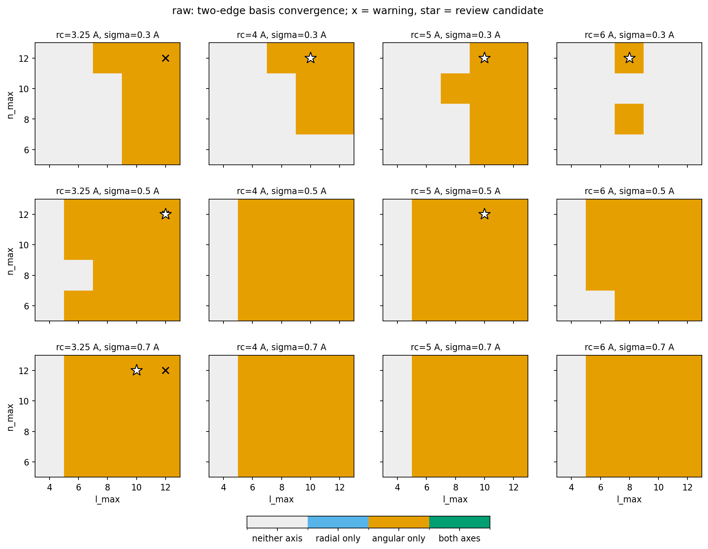
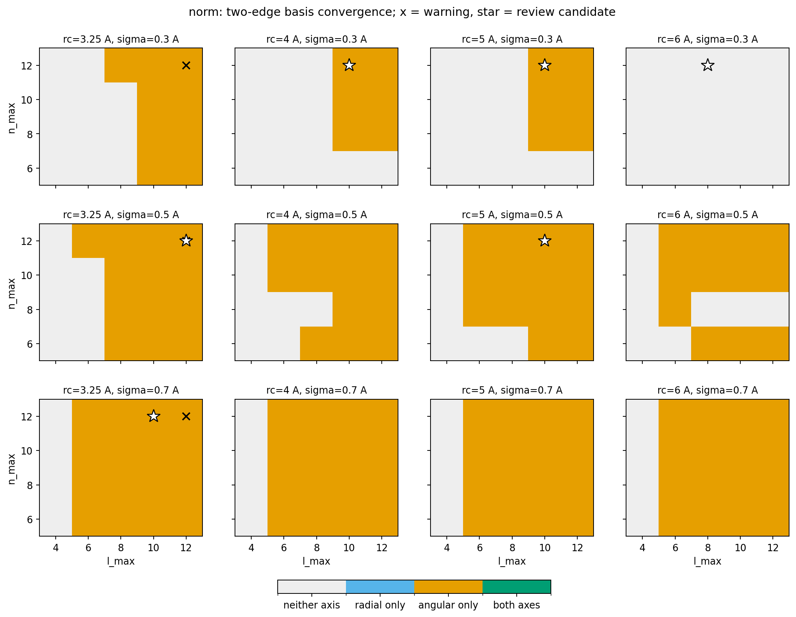
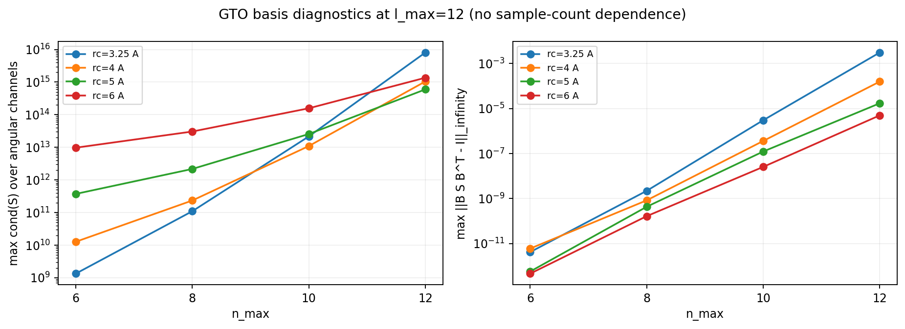
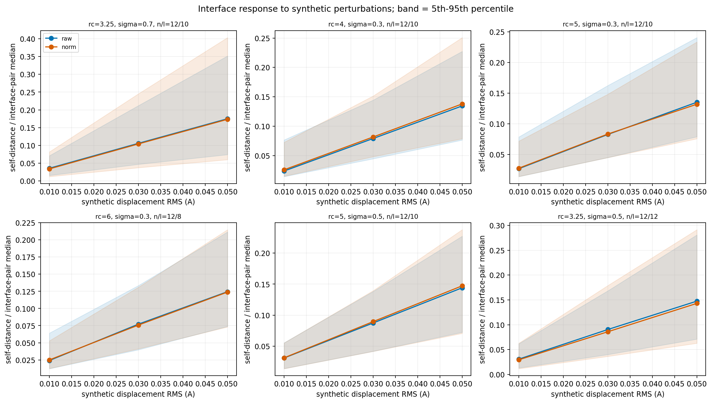
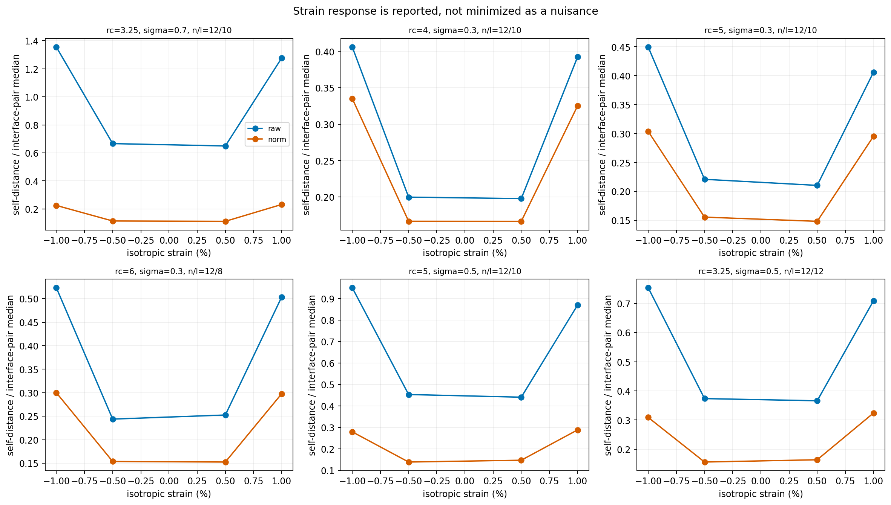
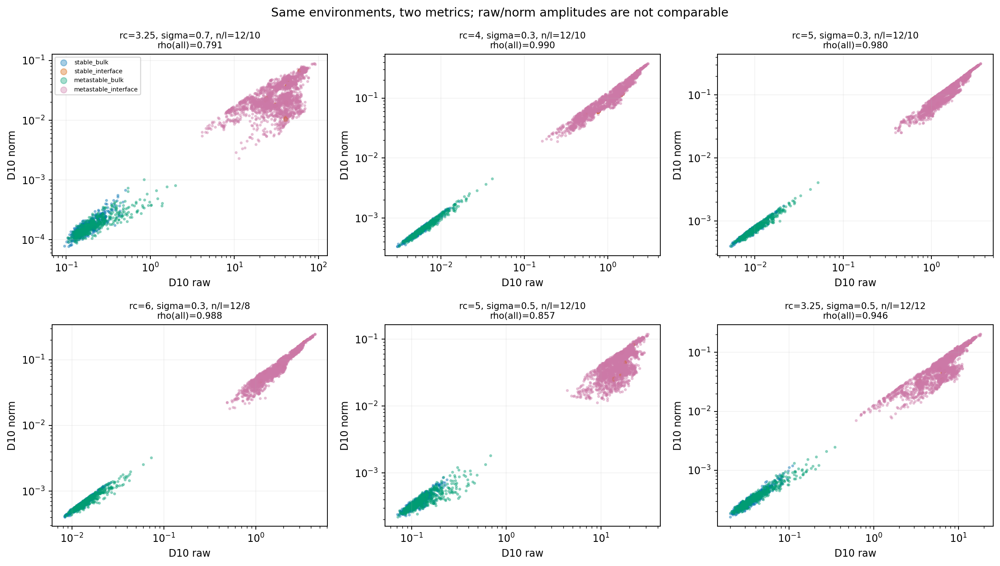
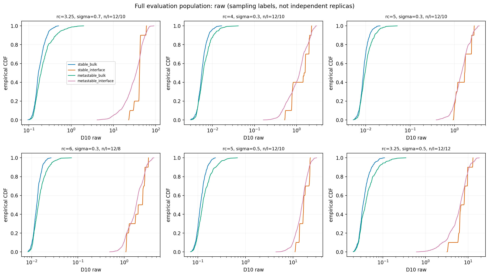
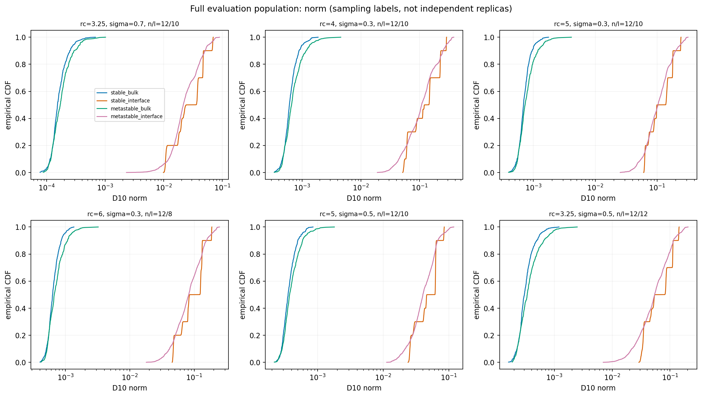
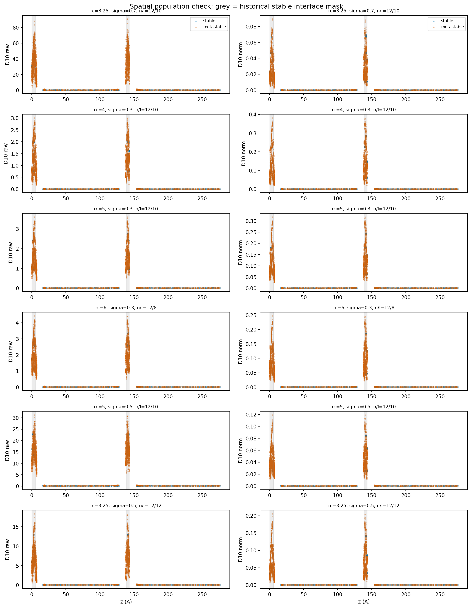

# Ni 双晶 SOAP 参数与距离联合遍历报告

生成时间：2026-11-01T11:24:23+08:00。所有“通过”均指本文预先登记的内部检查，不等于物理普适性。

## 结果摘要

- 240 组描述符配置：成功 240，失败 0；含警告配置 3。
- 两种距离均完成评价；按两条连续相邻边检查，raw 有 0 组、norm 有 0 组达到径向和角向共同收敛参考线。
- 已对 6 组候选做扰动/不变性和 4659 个评价中心复核；其中 3659 个中心未参与初筛，另有共同参考 400 个、备用参考 400 个。
- 平移、整体旋转、同元素置换的不变性检查：通过；最大相对向量变化 1.01e-09。
- 主距离未冻结。raw 保留幅度与方向，norm 去除向量整体幅度；本轮未把幅度直接解释成密度，也未按 stable/metastable 分离程度选参数。

## 预先固定的方法

- 数据为现有 stable、metastable 两个 Ni CFG，每个 47120 原子；输入哈希、环境版本和随机种子见 `protocol.json`。
- 240 组 = r_cut [3.25,4,5,6] × sigma [0.3,0.5,0.7] × n_max [6,8,10,12] × l_max [4,6,8,10,12]。
- 固定 DScribe GTO、Ni、PBC、逐中心、float64、无额外径向加权、无压缩；固定 DScribe 唯一项输出上的欧氏权重，未改成对称项重加权的原始 SOAP 核。
- 初筛 1000 个中心：每个构型 300 界面和 200 深体相。抽样按界面分箱、CNA/PTM 和空间层次进行，未使用 PEATOM 或 SOAP 值。
- 复现历史 200 分箱掩膜（非主导比例 >0.1，每箱 >=50），得到 1600/2059 个界面中心。深体相距离界面分箱边缘 >10 Å，且 CNA/PTM=1/1。
- 完整结构始终参与邻居搜索；抽样只减少中心。最大补齐搜索半径约 8.60 Å，小于最短盒长的一半。
- 主参考每个构型随机分层选 200 个深体相；备用每个构型另选 200 个。参考、备用参考、评价原子 ID 不重叠，不用能量过滤。
- 每组保存原始向量，归一化向量由同一产物派生；raw 与 norm 分别计算 D(k)、近邻和距离排序。
- 固定 20000 对分层原子对，包含四个人口组的十种组对类别。收敛逐类别检查最低 Spearman，不用总体相关掩盖组内变化。

## 展开收敛

固定 r_cut、sigma，分别增加 n_max 或 l_max。每条相邻边的条件：十种组对中最低距离 Spearman >=0.98、最大中位距离变化/高阶距离中位数 <=5%、1000 中心的平均前十近邻重合率 >=80%。

每个轴需要两条连续边均通过：内部节点用前后两边，最高阶用最后两边；最低阶只有一边，因此本轮不能被认定为已完成两边收敛验证。边界不通过时明确保留“网格内未收敛”，未事后放宽阈值。近邻并列与小距离排序可使此判据偏严格，因此同时报告三个原始指标。

网格颜色：灰=两个轴均未满足两边判据，蓝=仅径向，橙=仅角向，绿=两个轴；叉号=警告；星号=复核候选。详细边与类别汇总见 `convergence_edges.csv`、`convergence_summary.csv`。

主要瓶颈是径向。以下为相邻边通过数量；三项必须同时满足才算边通过。

| 距离 | 轴 | 三项均通过 | 总边数 | 排序通过 | 幅度变化通过 | 近邻通过 |
| --- | --- | --- | --- | --- | --- | --- |
| norm | l | 145 | 192 | 168 | 150 | 187 |
| norm | n | 0 | 180 | 0 | 0 | 0 |
| raw | l | 158 | 192 | 175 | 161 | 190 |
| raw | n | 0 | 180 | 0 | 0 | 0 |

六组候选 n_max=10→12 的每个原子对类别结果见 `radial_category_diagnostics.csv`。这能区分体相小距离排序与界面结构距离的变化，避免只凭最差汇总值解释机制。

## 径向边界补查：n_max=14、16

因主网格没有径向边通过，在六组已选候选的同一 r_cut、sigma、l_max 上额外检查 14/16；补查协议在计算前单独登记，原 240 组结果和判据保持原样。

12 个补查配置中 5 个生成向量、7 个构造失败；可比较的两种距离相邻边中 0/10 通过原判据。

| 补查配置 | 状态 | 警告数 | 正交化残差 |
| --- | --- | --- | --- |
| r3p25_s0p7_n14_l10 | failed | 1 | nan |
| r3p25_s0p7_n16_l10 | failed | 1 | nan |
| r4_s0p3_n14_l10 | ok | 11 | 0.04783 |
| r4_s0p3_n16_l10 | failed | 2 | nan |
| r5_s0p3_n14_l10 | ok | 1 | 0.002531 |
| r5_s0p3_n16_l10 | failed | 1 | nan |
| r6_s0p3_n14_l8 | ok | 0 | 0.002266 |
| r6_s0p3_n16_l8 | ok | 9 | 0.3607 |
| r5_s0p5_n14_l10 | ok | 1 | 0.002531 |
| r5_s0p5_n16_l10 | failed | 1 | nan |
| r3p25_s0p5_n14_l12 | failed | 1 | nan |
| r3p25_s0p5_n16_l12 | failed | 1 | nan |

例如 r_cut=6、sigma=0.3、l_max=8 的 n_max=16 虽能生成有限向量，其最大正交化残差约 0.361；不能把高阶有限结果当成准确真值。成功高阶配置和失败异常均保留在 `radial_extension/`。继续提高 n_max 未在这些补查配置中建立可信收敛。

另用四个观察尺度、n_max=10→12 做了对称项权重诊断：按 DScribe 单元素 l-major 顺序，对 n≠n′ 分量乘 √2 后分别计算 raw/norm。其 8 条诊断边仍未通过原判据，因此本轮所检验的径向变化不能仅归结为是否恢复对称项权重。该诊断不是主距离的替换，也未扩展为另一轮完整参数选择。见 `symmetry_weight_diagnostic.csv`、`metric_diagnostics.json`。分量顺序与唯一项来自 [DScribe v2.1.2 源码](https://github.com/SINGROUP/dscribe/blob/v2.1.2/dscribe/ext/soapGTO.cpp#L2240)。

## 数值警告

重叠矩阵来自 GTO 径向基函数，与原子样本数量无关。报告 cond(S) 及正交化残差 ||B S Bᵀ−I||∞，不把警告直接等同于所有距离失效。

| 含警告配置 | 最大条件数 | 最大正交化残差 |
| --- | --- | --- |
| r3p25_s0p3_n12_l12 | 8.064e+15 | 0.003056 |
| r3p25_s0p5_n12_l12 | 8.064e+15 | 0.003056 |
| r3p25_s0p7_n12_l12 | 8.064e+15 | 0.003056 |

## 候选与扰动检查

初筛后按收敛证据给每个 r_cut 保留一组，另保留一个展宽尺度和旧基准。所有候选在计算扰动和完整人口前即已写入 `candidates.json`；不是最终最优参数名单。

| 配置 | 距离 | 两轴收敛 | 警告数 | 0.01Å扰动/界面对距离 | 0.01Å近邻保留率 | 备用参考留出组最低ρ |
| --- | --- | --- | --- | --- | --- | --- |
| r3p25_s0p7_n12_l10 | raw | 否 | 0 | 0.03574 | 0.6567 | 0.7757 |
| r3p25_s0p7_n12_l10 | norm | 否 | 0 | 0.03394 | 0.6083 | 0.7814 |
| r4_s0p3_n12_l10 | raw | 否 | 0 | 0.02365 | 0.72 | 0.8299 |
| r4_s0p3_n12_l10 | norm | 否 | 0 | 0.02574 | 0.7044 | 0.8105 |
| r5_s0p3_n12_l10 | raw | 否 | 0 | 0.02657 | 0.6994 | 0.8592 |
| r5_s0p3_n12_l10 | norm | 否 | 0 | 0.02743 | 0.7028 | 0.8637 |
| r6_s0p3_n12_l8 | raw | 否 | 0 | 0.02413 | 0.7056 | 0.8524 |
| r6_s0p3_n12_l8 | norm | 否 | 0 | 0.02504 | 0.7011 | 0.8389 |
| r5_s0p5_n12_l10 | raw | 否 | 0 | 0.03082 | 0.6967 | 0.8449 |
| r5_s0p5_n12_l10 | norm | 否 | 0 | 0.03112 | 0.6856 | 0.8384 |
| r3p25_s0p5_n12_l12 | raw | 否 | 2 | 0.03072 | 0.6794 | 0.7675 |
| r3p25_s0p5_n12_l12 | norm | 否 | 2 | 0.02935 | 0.6628 | 0.7684 |

120 个固定中心（四组各 30）；对完整结构施加三维 RMS 0.01/0.03/0.05 Å 的随机位移，各三个固定种子；同一随机模式随幅度缩放。另施加 ±0.5%、±1% 均匀应变，以及平移/旋转/置换。所有位移均为合成探针，不代表温度或真实轨迹。

扰动图的分母是同构型界面—界面固定原子对距离的中位数，分子是扰动前后同中心的距离。它用于比较信号和扰动尺度，不能当作已校准的正确/错误分类阈值。阴影为中心和种子混合分布的 5%—95% 分位，不是独立样本置信区间。

## 两种距离的比较

d_raw²=(||p_i||−||p_j||)²+||p_i||||p_j|| d_norm²。每个网格配置都验证这一恒等式。归一化改变距离排序与近邻关系，不能将二者简单视为单位换算。不同参数的距离绝对值也不能直接按大小判优。

范数与名义 r_cut 内配位数的相关、raw/norm 的组内相关，以及对共同体相均值的平方距离范数贡献均单独保存。相关不证明范数只反映密度，也不证明 norm 是纯键角度量。见 `physical_audit.csv` 和 `review/*_decomposition.csv`。

下表是完整界面人口内部的 D_raw/D_norm 排序相关；比混合全部体相和界面的总体相关更能显示方法差别。

| 配置 | stable 界面ρ | metastable 界面ρ |
| --- | --- | --- |
| r3p25_s0p5_n12_l12 | 0.9182 | 0.8686 |
| r3p25_s0p7_n12_l10 | 0.7912 | 0.5196 |
| r4_s0p3_n12_l10 | 0.9986 | 0.9734 |
| r5_s0p3_n12_l10 | 0.9813 | 0.9507 |
| r5_s0p5_n12_l10 | 0.7054 | 0.6708 |
| r6_s0p3_n12_l8 | 0.9864 | 0.9731 |

## 完整人口与参考敏感性

固定候选复算所有 4659 个中心；分别报告初筛/留出人口、两个周期界面，检查 k=1/5/10/20、备用共同参考和按构型参考。参考或 k 改变可能影响细小的组内排序；不能只用混合人口的高相关宣称稳健。

详见 `review_summary.csv`、`reference_k_robustness.csv` 和 `candidate_agreement.csv`。近邻原子和两个周期界面均有相关性，3659 个留出原子不是独立晶界验证集。

## 参数处置与适用范围

- raw：no_audited_candidate_meets_predeclared_basis_convergence；候选 无。
- norm：no_audited_candidate_meets_predeclared_basis_convergence；候选 无。
- 若有满足基函数收敛、无警告和不变性检查的候选，只把维数较小者列为经济性优先的暂定候选，不宣称其物理观察范围最优。
- 本轮没有物理校准的位移容差，也没有独立 GB 重复；不据此冻结唯一 r_cut、sigma 或主距离。没有通过的配置如实标为未收敛，未用最高阶代替真值。
- 已导出每组候选的 8 个留出界面环境：raw/norm 排名分歧最大的两类，以及 norm 的高/低例子。XYZ 位于 `representatives/`，索引在 `representative_environments.csv`，投影见 `figures/neighborhoods_*.png`。这些是用于检查解释的例子，不是独立物理真值标签。

## 计算与复现

- 240 组单组计时之和 6.55 分钟（包含向量保存和初筛后处理，不含脚本准备）。
- Python 3.13.11；DScribe 2.1.2；NumPy 2.4.4；SciPy 1.17.1。单进程单线程。
- `progress.jsonl` 保留阶段时间；`protocol.json` 保留事先固定的方法、输入哈希和环境；源代码快照在 `source/`。
- 运行顺序：run_sweep.py prepare → sweep → convergence；validate_candidates.py perturb → review；build_report.py。从本工作区 `work/ni_soap_sweep_20261101/` 执行对应脚本。
- `vectors/` 保留全部 240 组原始初筛向量；`metrics/` 保留两种距离、kNN 和 D(k)；`review/` 保留候选的完整人口向量及逐原子结果。

方法参考：[DScribe SOAP 文档](https://singroup.github.io/dscribe/latest/tutorials/descriptors/soap.html)、[GTO 与截断扩展实现](https://singroup.github.io/dscribe/latest/_modules/dscribe/descriptors/soap.html)。输入来源为用户仓库，版本和实际文件哈希见协议。
