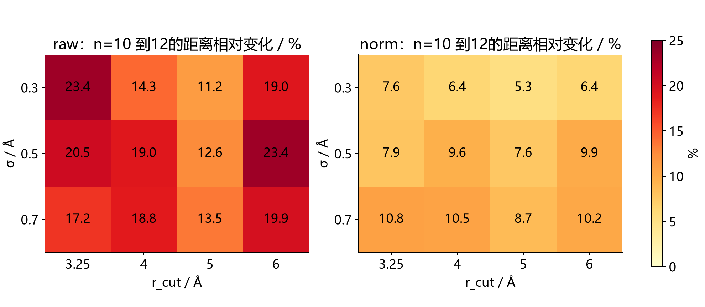
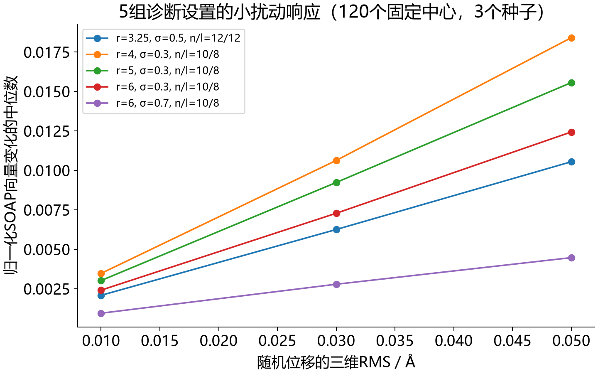
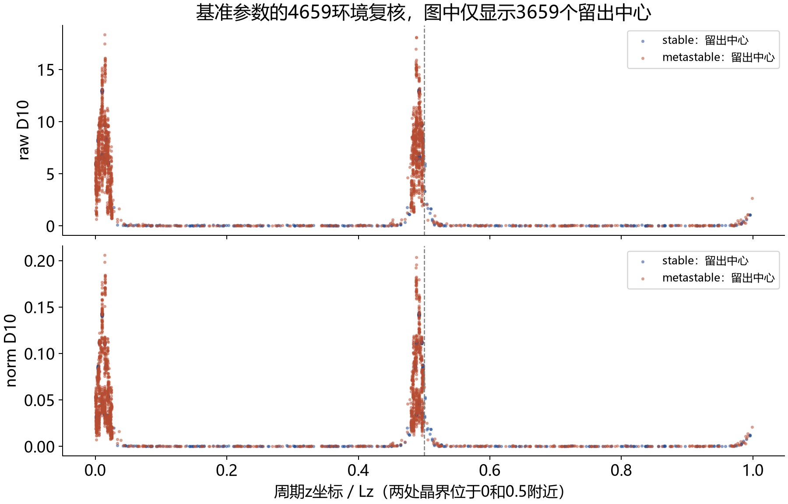

# Ni SOAP正式240组扫描记录（2026年11月1日）

240组全部完成，均产生有限SOAP向量，没有零范数；3组记录到GTO基处理的病态矩阵警告。结果不支持冻结现有参数或宣称得到最优参数。

固定设置为Ni、周期边界、GTO、average=off、float64、不额外加权。r_cut=3.25/4/5/6 Å，sigma=0.3/0.5/0.7 Å，n_max=6/8/10/12，l_max=4/6/8/10/12，四维组合4×3×4×5=240。SOAP计算实际合计约6.4分钟，不含后续复核和绘图。

每个完整输入构型47120原子，邻域搜索始终使用完整构型。stable和metastable各取300个界面中心和200个体相中心，总评价中心1000。界面按两处周期晶界、空间分位和CNA/PTM类别分层；每个参数使用相同ID。每状态取200个独立参考，参考沿周期z方向距已识别界面区超过9 Å，不按势能筛选，与原4659个评价人口完全不重叠。随机种子20261101。输入SHA256、cell、所有ID见manifest.json，选择索引见selections.npz。

## 距离和收敛

d_raw=||p_i-p_j||₂；d_norm=||p_i/||p_i||-p_j/||p_j||||₂。D10是到共同400参考库中最近10个环境的平均距离。两种距离并行，不因任一类间距离最大而选参数。

每状态各固定600对BB、BI、II，共3600对。相邻径向阶数比较180组，角向192组。每一比较同时要求：固定对距离Spearman ρ≥0.98、相对变化中位数≤5%、固定1000评价中心的前10近邻平均重合率≥80%。相对变化的分母使用较高阶距离，低值分母以距离中位数的百万分之一保护。门槛是预设工程容差，不是材料物理定律；近理想体相中极小距离和近邻并列会影响重合指标。

| 比较方向 | 原始距离通过数 | 归一化距离通过数 | 两者同时通过 |
|---|---:|---:|---:|
| n_max相邻增加 | 0 / 180 | 0 / 180 | 0 / 180 |
| l_max相邻增加 | 179 / 192 | 181 / 192 | 178 / 192 |

基准r_cut=3.25 Å、sigma=0.5 Å、n=l=12共1014维，记录到病态矩阵警告；另外两组警告是同一r/n/l下sigma=0.3和0.7。这不等于向量已经无效，但应保留为数值可靠性限制。

基准l=12、n从10增到12时，d_raw的ρ=0.9764、距离变化中位数20.5%、前10近邻重合72.8%；d_norm分别为0.9916、7.8%、75.4%。单看排序相关高不能证明完整收敛。

基准还按两个状态的BB、BI、II各600对分别复核：n=10至12的原始距离变化中位数为15.0%—26.9%，归一化距离为6.7%—10.6%，各组都超过5%。因此基准的径向问题并非仅由体相极小距离的近邻并列造成；见baseline_grouped_radial_audit.json。

## 额外诊断复核

由于没有径向收敛合格组合，本轮不产生“最优候选”。保留5组诊断代表：原基准，以及4/.3/10/8、5/.3/10/8、6/.3/10/8、6/.7/10/8（按r、sigma、n、l顺序）。它们用于检查尺度与病态警告影响，不称为筛选通过参数。

每组使用固定120个探针（两状态×界面/体相×30）检验平移、刚体旋转、原子顺序置换、三维RMS位移0.01/0.03/0.05 Å×3种子，以及均匀应变±0.5%/±1%。另计算完整4659个既有评价环境，其中3659个中心未参加初筛；共同参考400不变，并保留k=5/10/20和两来源参考库的敏感性输出。

原基准的刚体变换最大原始差异约5.1×10⁻⁸、归一化差异约6.2×10⁻¹⁰；可作为计算不变性检查。扰动响应随平滑与观察范围变化，但不能将向量变化更小单独解释为更好的结构描述。

## 下一步

优先核查径向基收敛和条件数，评估数值稳定的展开设置或基函数对照，保留两种距离。随后进行Li迁移小试，再扩展晶界样本。不要通过降低判据或最大化stable/metastable标签差异来补出最优值。这里的stable/metastable沿用输入文件名，本轮未独立证明其热力学身份。

当前仅两份既有Ni构型，留出原子仍属于同一构型，不代表独立晶界泛化验证。完整结果见results.csv、convergence.json、diagnostics_summary.json及diagnostics子目录；所有计算脚本保存在同目录。
