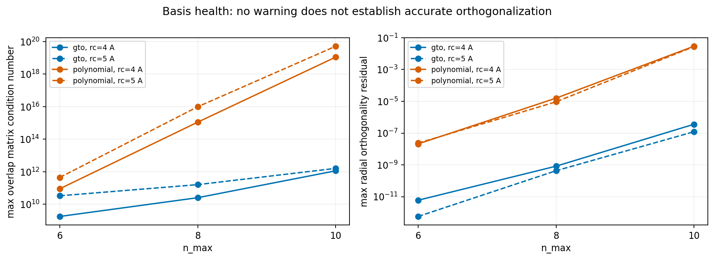
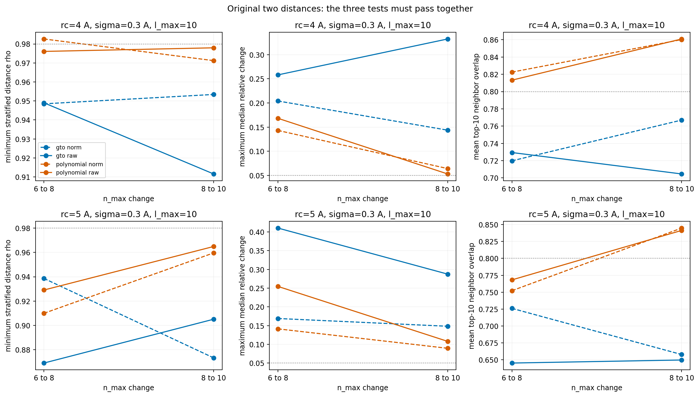
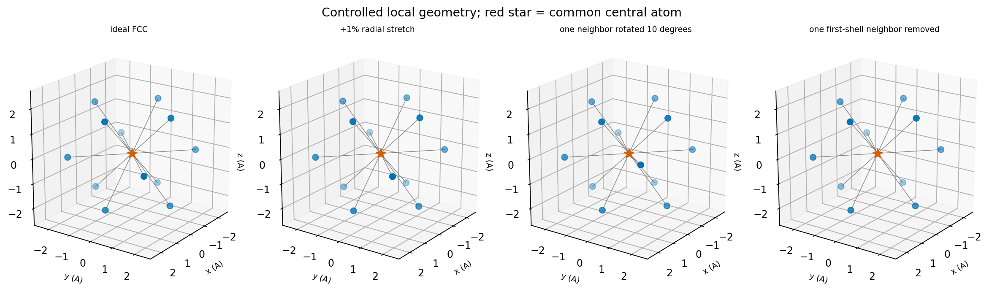
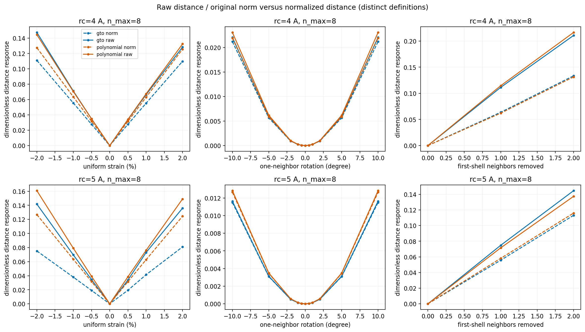
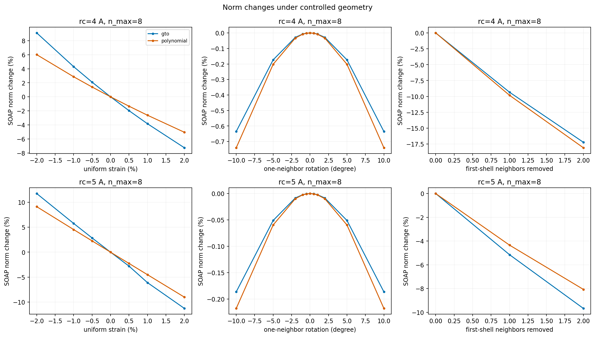
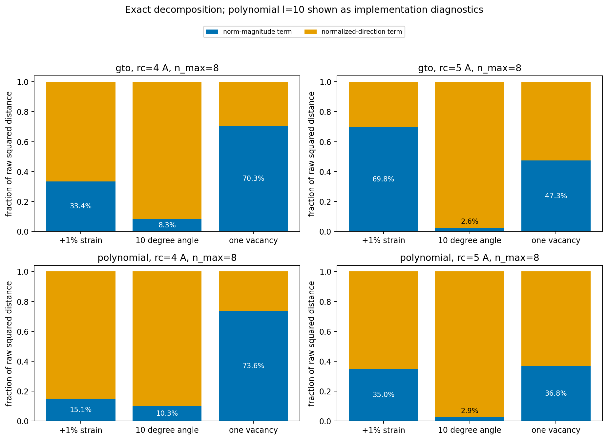

# Ni SOAP 径向基函数与受控结构对照

生成时间：2026-11-01T11:52:51+08:00。这是上一轮的独立补充，原 240 组数据、协议和判据保持原样。

## 主要结论

- **物理验收未通过：原生 polynomial、l_max=10 在整体旋转后出现最高约 2.752% 的相对向量变化。其近邻稳定性提高不能作为物理准确性提高的证据。GTO 对照通过不变性检查。**
- 六组 polynomial 全部生成有限向量，均没有警告；但 n_max=10 的实际径向正交化残差为 0.02766—0.02924。无警告不能证明正交化准确。
- polynomial 在本轮多个相邻阶数比较中提高了近邻重合率，尤其是 8→10；仍未通过全部预先设定的收敛条件，不能直接替换 GTO 后冻结参数。
- 夹角不变的均匀伸缩仍改变 d_norm；中心到各邻居半径不变的角度扰动仍改变范数。norm 含有径向信息，SOAP 范数不是密度的专用指标。
- 两种距离均对邻居缺失有响应。范数项在 raw 平方距离中的占比随扰动、观察范围和基函数改变，不能直接套用一个固定密度占比。

## 固定的试验设置

- 新计算：r_cut=4/5 Å、sigma=0.3 Å、l_max=10、n_max=6/8/10，共六组 polynomial；GTO 对照复用原六组向量。
- 真实 Ni 对照继续使用原 1000 初筛中心、400 个不重叠的深体相参考、同一批 20000 分层原子对。没有重新抽样，没有能量过滤。
- 主分析仍是 DScribe 唯一项向量的 d_raw 和归一化后的 d_norm。对称项 √2 权重仅作独立诊断，未覆盖主距离或原选择结果。
- 比较不同基函数诱导的距离、近邻和 D(k)，不直接比较其系数坐标。相同 n_max 不代表相同逼近精度；跨基函数差别也不应全部归结为数值误差。
- 原相邻边标准保持不变：十类原子对最低 Spearman >=0.98，最大中位相对距离变化 <=5%，平均前十近邻重合率 >=80%。

## 径向数值诊断

polynomial 的诊断直接积分 DScribe 实际生成的径向函数：使用与实现匹配的 100 点 Gauss-Legendre 节点，计算 ∫g_n(r)g_m(r)r²dr 与单位矩阵的无穷范数差。节点一致性已经检查。GTO 对照沿用原重叠矩阵诊断。条件数依赖基函数缩放，应结合正交化残差理解。

| 配置 | 重叠矩阵条件数 | 径向正交化残差 | 警告数 |
| --- | --- | --- | --- |
| r4_s0p3_n6_l10 | 9.0682e+10 | 2.0932e-08 | 0 |
| r4_s0p3_n8_l10 | 1.1247e+15 | 1.5857e-05 | 0 |
| r4_s0p3_n10_l10 | 1.1134e+19 | 0.029243 | 0 |
| r5_s0p3_n6_l10 | 4.5129e+11 | 2.3542e-08 | 0 |
| r5_s0p3_n8_l10 | 9.9347e+15 | 9.3238e-06 | 0 |
| r5_s0p3_n10_l10 | 5.2029e+19 | 0.027665 | 0 |

polynomial 的 n_max=6 残差约 2×10⁻⁸，8 为 10⁻⁵ 量级，10 增至约 0.03。增加阶数时逼近能力与数值误差同时变化，因此不能把最高阶结果当作真值。

## 验收失败：polynomial 的 l=10 旋转偏差

使用原来 1e-8 的相对不变性容差进行验收时，发现六组原生 polynomial、l_max=10 均不能通过整体旋转检查。平移和同元素置换保持数值稳定，GTO 的整体旋转也稳定。该结果作为科学验收失败保留，未放宽阈值。

补充定位固定 n_max=8，分别测试 r_cut=4/5 Å，l_max=0/4/6/8/9/10，三种整体旋转，并同时使用周期 FCC 超胞和非周期 7 Å 局域簇，共 144 次比较。12 个失败全部属于 polynomial、l_max=10；低阶和 GTO 在这些旋转下通过。非周期簇重复了周期结构的偏差，排除了“仅由周期边界引起”的解释。

| rc | 最高角阶 | GTO 最大相对旋转变化 | polynomial 最大相对旋转变化 |
| --- | --- | --- | --- |
| 4 | 9 | 5.5634e-13 | 1.9525e-15 |
| 4 | 10 | 5.5633e-13 | 0.0049391 |
| 5 | 9 | 6.7969e-13 | 1.49e-15 |
| 5 | 10 | 6.7953e-13 | 0.027312 |

逐 l 通道诊断将偏差集中到 l=10，l≤9 通道保持数值稳定。公开 v2.1.2 `soapGeneral.cpp` 中，factorY(l,m) 使用 l(l+1)/2+m 索引，factorListSet 对 (l,m)=(10,10) 对应的 c[65] 给出 0，并由 getYlmi 使用。这是与观测吻合的实现线索；本轮未修改或重编译依赖库，尚未用修补前后对照证明完整根因。源码与哈希保存在 `implementation/`。

证据：`rotation_audit.csv`、`rotation_audit_by_l.csv`、`fcc_responses.csv`。报告里的 polynomial 原生数据用于记录表示与实现诊断；物理响应解释优先采用已经通过不变性检查的 GTO 对照。低阶旋转测试通过，也不等于其径向展开或角向精度已经收敛。

## 真实 Ni 环境的径向比较

| 基函数 | rc | 低阶 | 高阶 | 距离 | 最低ρ | 最大相对变化 | 近邻重合率 | 全部条件 |
| --- | --- | --- | --- | --- | --- | --- | --- | --- |
| gto | 4 | r4_s0p3_n6_l10 | r4_s0p3_n8_l10 | raw | 0.94902 | 0.25803 | 0.7294 | 未通过 |
| gto | 4 | r4_s0p3_n6_l10 | r4_s0p3_n8_l10 | norm | 0.94849 | 0.20407 | 0.7198 | 未通过 |
| gto | 4 | r4_s0p3_n8_l10 | r4_s0p3_n10_l10 | raw | 0.91159 | 0.33235 | 0.7046 | 未通过 |
| gto | 4 | r4_s0p3_n8_l10 | r4_s0p3_n10_l10 | norm | 0.95342 | 0.14365 | 0.767 | 未通过 |
| gto | 5 | r5_s0p3_n6_l10 | r5_s0p3_n8_l10 | raw | 0.86912 | 0.41041 | 0.6451 | 未通过 |
| gto | 5 | r5_s0p3_n6_l10 | r5_s0p3_n8_l10 | norm | 0.93862 | 0.16894 | 0.726 | 未通过 |
| gto | 5 | r5_s0p3_n8_l10 | r5_s0p3_n10_l10 | raw | 0.90512 | 0.28742 | 0.6496 | 未通过 |
| gto | 5 | r5_s0p3_n8_l10 | r5_s0p3_n10_l10 | norm | 0.87336 | 0.14823 | 0.6577 | 未通过 |
| polynomial | 4 | r4_s0p3_n6_l10 | r4_s0p3_n8_l10 | raw | 0.97606 | 0.16819 | 0.8132 | 未通过 |
| polynomial | 4 | r4_s0p3_n6_l10 | r4_s0p3_n8_l10 | norm | 0.98261 | 0.14311 | 0.8225 | 未通过 |
| polynomial | 4 | r4_s0p3_n8_l10 | r4_s0p3_n10_l10 | raw | 0.97796 | 0.053062 | 0.8609 | 未通过 |
| polynomial | 4 | r4_s0p3_n8_l10 | r4_s0p3_n10_l10 | norm | 0.97121 | 0.064174 | 0.8602 | 未通过 |
| polynomial | 5 | r5_s0p3_n6_l10 | r5_s0p3_n8_l10 | raw | 0.92911 | 0.25463 | 0.7682 | 未通过 |
| polynomial | 5 | r5_s0p3_n6_l10 | r5_s0p3_n8_l10 | norm | 0.90999 | 0.14127 | 0.7522 | 未通过 |
| polynomial | 5 | r5_s0p3_n8_l10 | r5_s0p3_n10_l10 | raw | 0.96486 | 0.10789 | 0.8414 | 未通过 |
| polynomial | 5 | r5_s0p3_n8_l10 | r5_s0p3_n10_l10 | norm | 0.95959 | 0.0894 | 0.8449 | 未通过 |

主距离相邻边 0/16 通过；对称权重诊断边 0/16 通过。

polynomial 8→10 的平均近邻重合率约 0.84—0.86，高于本轮 GTO 对应的约 0.65—0.77。但其 n_max=10 正交化残差也明显增大，这只能说明该分支值得做稳定化后的数值对照，不能据此认定已经收敛。组内细节在 `distance_comparisons_by_category.csv`。

跨基函数的全部 24 个距离比较记录在 `distance_comparisons.csv`，其 comparison=cross_basis 部分是表示差异诊断，表中通过标记只表示满足同一数值参考线，不是物理等价检验。

## FCC 受控几何

从原深体相参考原子的前 12 近邻距离估计 FCC 晶格常数 a=3.506232781 Å；理想第一壳半径 2.479280976 Å。建立 8×8×8 常规 FCC 超胞，共 2048 个原子，跟踪同一个中心原子的原始身份。

22 个构型包含：基准；±0.5%、±1%、±2% 均匀伸缩；一个第一壳邻居绕中心转动 ±0.5°、±1°、±2°、±5°、±10°；移除一个或一对相反方向第一壳邻居；整体平移、旋转和原子置换。

- 角度试验检查所有剩余原子到中心的半径不变、第一壳仍为 12。
- 伸缩试验检查第一壳邻居间夹角不变。
- 缺邻居试验检查第一壳配位数依次为 11、10，剩余原子半径不变。
- 平移、旋转、置换用于数值不变性检查。合成几何不代表温度、能垒或真实缺陷平衡态。

所有几何验证值见 `fcc_geometry.csv`；完整周期结构在 `fcc_structures/`，可用结构软件查看。缺邻居同时改变配位和相对密度；均匀伸缩同时改变距离和密度，不把它们称为单一信息通道。

## 两种距离到底响应什么

为展示响应，将 raw 距离除以原始向量范数，记为 relative_raw；norm 距离仍是单位向量间欧氏距离。它们均无量纲，但定义不同，不按谁的数值更大判优。

以数值状况较好的 GTO、rc=4 Å、sigma=0.3 Å、n_max=8、l_max=10 为例：

| 几何变化 | 范数变化% | raw/原始范数 | d_norm | 范数项占raw平方距离% |
| --- | --- | --- | --- | --- |
| strain_+0.01 | -3.8349 | 0.066322 | 0.055179 | 33.434 |
| angle_+10 | -0.63518 | 0.022085 | 0.021219 | 8.2718 |
| vacancy_1 | -9.3401 | 0.11141 | 0.063784 | 70.284 |

这些例子直接说明：归一化并没有消除径向结构变化；向量范数也会随纯角度重排变化。删除邻居的范数项较大，是该配置该探针的结果，不代表实际晶界中范数项的唯一物理来源。

精确分解为 relative_raw²=(norm_ratio−1)²+norm_ratio·d_norm²，其中 norm_ratio=||p_new||/||p_original||。数值恒等式单独验证；极小的不变性距离不解释其分解百分比。

## 建议的后续处置

1. 继续并行报告 d_raw、d_norm 和范数，避免把它们预先贴成“密度距离”与“纯角度距离”。
2. 先处理原生 polynomial 在 l=10 的旋转偏差，再诊断高阶径向正交化。修改实现或限制角阶均需单独对照和重新验证；当前 l=10 数据不用于冻结物理距离，暂不扩大阶数。
3. 同时保留“表示收敛”与“科学结论稳健”两类证据。前者本轮未达到原标准，后者需要针对具体结构比较问题判断，不能事后放宽原标准制造通过结果。
4. 受控结构可帮助解释响应，但未校准可接受的热扰动或应变范围，也未提供独立晶界重复，因此本轮不冻结唯一参数或唯一主距离。

## 复现与文件

- `protocol.json`：执行前固定的设置、主分析约定、六组 GTO 来源文件哈希。
- `polynomial_summary.csv`、`basis_health_comparison.csv`：数值诊断。
- `distance_comparisons.csv`、`distance_comparisons_by_category.csv`：全部距离比较和十类原子对细节。
- `fcc_responses.csv`、`fcc_decomposition.csv`：两种距离、范数和分解。
- `vectors/`、`metrics/`、`probe_vectors/`：原始向量及派生数据。
- `verification.json`：数值、几何、原始数据未改变等检查。
- `source/`：运行脚本、依赖脚本快照；`implementation/` 保留实际安装版本的 polynomial 基函数函数。

从工作区依次执行 `work/ni_soap_sweep_20261101/radial_followup.py prepare`、`scan`、`probes`、`analyze`、`rotation_audit`、`report`、`verify`；已有逐配置结果可复用。

原主扫描协议 SHA256：4af522b38b79e318ef2315889aa8e3f0541bbeb381cfa8671afb795b58f7d8e1。

算法参考：[DScribe SOAP 文档](https://singroup.github.io/dscribe/latest/tutorials/descriptors/soap.html)。实际实现已经保存在本地，所有结论以本次环境的输出为依据。
